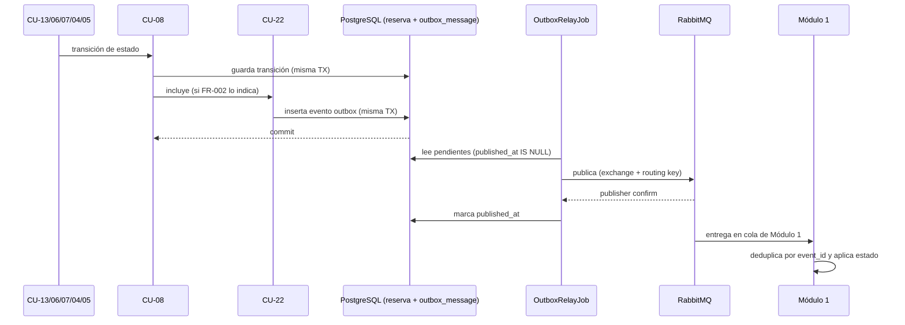
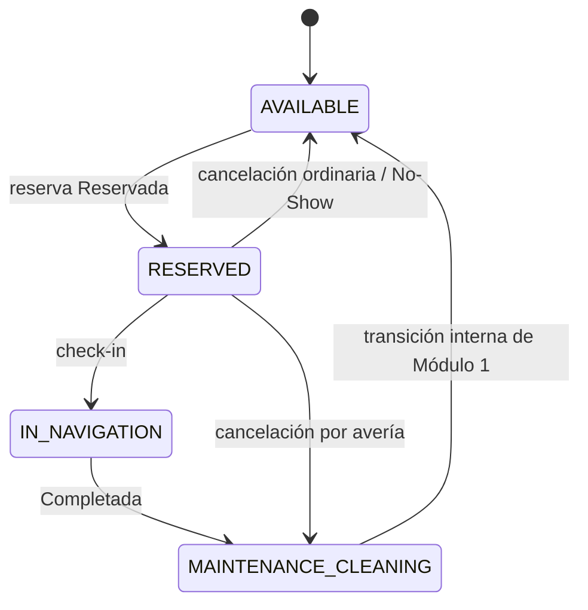

# Contrato de Interfaz Asíncrona: CU-22 Recibir Información de Estado Operativo

## 1. Identificación y Metadatos

- **Identificador del Contrato**: `ASYNC-M2-CU22-NOTIFICACION-ESTADO-OPERATIVO`
- **Módulo Responsable**: Módulo 2 – Operación de Reservas, Tiempos y Cancelaciones
- **Tipo de Interfaz**: Asíncrono, unidireccional (AMQP / RabbitMQ), saliente hacia Módulo 1
- **Actor / Consumidor Autorizado**: 
  - `Módulo 1 – Gestión de Flota y Activos P2P` (consume la cola de Módulo 1 y materializa `Asignar estado operativo`)
- **Caso de Uso Base / Relaciones**: 
  - Incluido por: `Actualizar estado reserva` (`<<include>>` - CU-08), único disparador.
  - Relación hermana: `Recibir Estado de Reserva` (`CU-14` → Módulo 3), independiente; el fallo de una notificación no invalida la otra.
- **Contrato Técnico de Referencia**: `context/consistencia-m2-m1.md`
- **Versión del Contrato**: 1.0.0
- **Fecha de Creación**: 2026-10-22

---

## 2. Propósito y Alcance de la Interfaz

Esta interfaz asíncrona permite a Módulo 2 informar a Módulo 1 el **estado operativo de la embarcación ya mapeado** cada vez que una reserva consolida una transición notificable, para que el inventario náutico refleje los compromisos de navegación y los bloqueos de la plataforma.

### Responsabilidades de la Interfaz:

1. **Traducción de Estado (FR-002)**:
   - Módulo 2 envía el **estado operativo resultante**, nunca el estado crudo de la reserva.
   - La correspondencia vigente es la tabla de FR-002 de `features/CU-22-recibir-informacion-estado-operativo/spec.md`, que es su **única fuente de verdad**; su copia de referencia vive en `context/consistencia-m2-m1.md`.
2. **Encolado Transaccional (FR-005)**:
   - El evento se registra en el outbox **en la misma transacción local** que consolida la transición de estado de la reserva.
   - Un proceso aparte (`OutboxRelayJob`) publica el evento en RabbitMQ; la transición y su notificación se confirman juntas.
3. **Entrega Garantizada (FR-006)**:
   - No existe envío síncrono directo. La entrega se gobierna con reintentos, backoff exponencial con jitter y derivación a DLQ con alerta.
   - La entrega es *at-least-once*; Módulo 1 deduplica por identificador de evento.
4. **Idempotencia por Transición (FR-004)**:
   - Cada transición genera un `event_id` (UUID) único que se conserva en todos los reintentos y viaja también en el header `Message-Id`.
5. **Regla de Negocio "Sin Dinero" (FR-007)**:
   - La notificación es puramente operativa: **jamás** incluye montos, tarifas, penalidades, valores de reembolso ni datos de liquidación o pago.
6. **Sin Respuesta Síncrona ni Reversión (FR-008)**:
   - Módulo 2 no espera una respuesta de negocio de Módulo 1 ni altera la transición local según el resultado de la entrega; la consistencia es eventual y se alcanza por reintento.
7. **Fuera de Alcance (FR-009)**:
   - No se valida ni resuelve doble reserva en el marco de esta notificación; esa prevención es responsabilidad interna de Módulo 2 y ocurre antes de confirmar la reserva.
   - No se notifican las transiciones a `Iniciada`, `Pendiente de pago`, `Expirada` ni `Pago Fallido`.

---

## 3. Definición de la Interfaz

- **Protocolo**: AMQP 0-9-1 (RabbitMQ), publicación unidireccional
- **Operación**: `publish` a un exchange de tipo `topic`
- **Formato de Mensaje**: `application/json`
- **Codificación**: `UTF-8`

### 3.1 Encabezados AMQP (Headers)

| Header | Tipo | Obligatorio | Descripción |
| :--- | :--- | :--- | :--- |
| `Message-Id` | String (UUID) | Sí | Identificador único del evento; mismo valor que `event_id`. Módulo 1 lo usa para descartar duplicados. |
| `Content-Type` | String | Sí | Debe ser `application/json`. |

### 3.2 Destino y Enrutamiento

| Elemento | Valor | Descripción / Reglas |
| :--- | :--- | :--- |
| `Exchange` | `<exchange-pendiente-de-definir>` | Exchange de tipo `topic`. Convención de referencia del contrato con M3: `seashare.<dominio>`. |
| `Routing key` | `<routing-key-pendiente-de-definir>` | Convención de referencia del contrato con M3: `<entidad>.<evento>`. |
| `Cola de Módulo 1` | `<nombre-cola-pendiente-de-definir>` | Cola consumida por Módulo 1. Convención de referencia del contrato con M3: `<consumidor>.<evento>.v1`. |

> Los tres nombres están **pendientes de definir** y se acuerdan con Módulo 1. Se sigue la convención del contrato de M3 (`CU-14-recibir-estado-reserva/plan.md`), pero este contrato no fija nombres definitivos.

### 3.3 Flujo de Entrega

1. Un caso de uso de negocio (CU-13, CU-06, CU-07, CU-04 o CU-05) invoca a CU-08 para consolidar la transición de la reserva.
2. CU-08 aplica la tabla FR-002 y, si la transición es notificable, invoca a CU-22.
3. CU-22 genera el `event_id` y escribe el evento en `outbox_message` dentro de la misma transacción local.
4. Al confirmarse el commit, `OutboxRelayJob` publica el evento en el exchange con la routing key acordada.
5. El broker confirma la recepción (publisher confirm); recién entonces el relay marca `published_at`.
6. Módulo 1 consume el mensaje de su cola, deduplica por `event_id` y aplica el estado operativo.



> Los pasos 3–5 son asíncronos respecto del flujo de negocio: el caso de uso no espera a Módulo 1.

---

## 4. Estructura de Datos (Schema JSON)

### 4.1 Cuerpo del Mensaje (Payload)

```json
{
  "vessel_id": "string (UUID)",
  "operational_status": "string (AVAILABLE | RESERVED | IN_NAVIGATION | MAINTENANCE_CLEANING)",
  "occurred_at": "string (ISO 8601 timestamp con zona horaria)",
  "event_id": "string (UUID)"
}
```

#### Descripción de Campos del Mensaje

| Campo | Tipo | Obligatoriedad | Descripción |
| :--- | :--- | :--- | :--- |
| `vessel_id` | String (UUID) | No nulo | Identificador de la embarcación en Módulo 1. |
| `operational_status` | String (Enum) | No nulo | Estado operativo resultante, ya mapeado (`AVAILABLE`, `RESERVED`, `IN_NAVIGATION`, `MAINTENANCE_CLEANING`). Nunca contiene el estado crudo de la reserva. |
| `occurred_at` | String (ISO 8601) | No nulo | Marca temporal exacta de la transición que originó el aviso, con zona horaria. |
| `event_id` | String (UUID) | No nulo | Identificador único por transición; se conserva en todos los reintentos y coincide con `Message-Id`. |

### 4.2 Valores del Estado Operativo

| Valor | Significado |
| :--- | :--- |
| `AVAILABLE` | Disponible |
| `RESERVED` | Reservado |
| `IN_NAVIGATION` | En Navegación |
| `MAINTENANCE_CLEANING` | En Mantenimiento/Limpieza |

Módulo 1 sólo reconoce estos cuatro estados operativos. Cualquier otro valor lo registra como inconsistencia y no hace nada; por eso Módulo 2 no publica nada fuera de la tabla de FR-002.

---

## 5. Ejemplos de Publicación

### Ejemplo 1: Reservada (bloqueo por pago confirmado)

```json
{
  "vessel_id": "d3b07384-d113-49cd-a5d6-812e9bcfc101",
  "operational_status": "RESERVED",
  "occurred_at": "2026-10-22T12:05:00-05:00",
  "event_id": "7f3c1a9e-2b64-4d0f-9c81-5a2d6e4b1101"
}
```

### Ejemplo 2: En navegación (check-in)

```json
{
  "vessel_id": "d3b07384-d113-49cd-a5d6-812e9bcfc101",
  "operational_status": "IN_NAVIGATION",
  "occurred_at": "2026-10-22T14:10:00-05:00",
  "event_id": "8a4d2b0f-3c75-4e1a-8d92-6b3e7f5c2202"
}
```

### Ejemplo 3: Completada (señal hacia Mantenimiento/Limpieza; el retorno a Disponible es interno de Módulo 1)

```json
{
  "vessel_id": "d3b07384-d113-49cd-a5d6-812e9bcfc101",
  "operational_status": "MAINTENANCE_CLEANING",
  "occurred_at": "2026-10-25T18:30:00-05:00",
  "event_id": "9b5e3c1a-4d86-4f2b-9e03-7c4f8a6d3303"
}
```

### Ejemplo 4: Cancelada ordinaria (liberación; sólo si ya había llegado a Reservada)

```json
{
  "vessel_id": "d3b07384-d113-49cd-a5d6-812e9bcfc101",
  "operational_status": "AVAILABLE",
  "occurred_at": "2026-10-24T10:00:00-05:00",
  "event_id": "0c6f4d2b-5e97-4a3c-8f14-8d5a9b7e4404"
}
```

### Ejemplo 5: Cancelada por avería mecánica (señal hacia Mantenimiento/Limpieza; sólo si ya había llegado a Reservada)

```json
{
  "vessel_id": "d3b07384-d113-49cd-a5d6-812e9bcfc101",
  "operational_status": "MAINTENANCE_CLEANING",
  "occurred_at": "2026-10-24T10:00:00-05:00",
  "event_id": "1d7a5e3c-6f08-4b4d-9a25-9e6b0c8f5505"
}
```

---

## 6. Respuestas de Error, Reintentos y Códigos

La interfaz es unidireccional: Módulo 2 no recibe una respuesta de negocio ni un sobre de error de Módulo 1. Los fallos se gestionan en el mecanismo de entrega.

| Situación / Código | Causa | Reacción del Mecanismo de Entrega | Impacto en la Transición |
| :--- | :--- | :--- | :--- |
| Broker caído o conexión rechazada | RabbitMQ no disponible | El evento queda en el outbox y se reintenta con backoff (1 s, 5 s, 25 s, 125 s) | La transición local ya está confirmada |
| **`5xx` o Timeout** | Indisponibilidad transitoria de Módulo 1 | Reintento con backoff; máximo 5 intentos | Sin reversión local |
| **`4xx` permanente** | Embarcación inexistente o estado operativo no reconocido | Sin reintento; derivación directa a DLQ con alerta | Sin reversión local |
| Quinto fallo agotado | Se agotó la política de reintentos | DLQ + alerta crítica; el evento no se descarta | Sin reversión local |
| Outbox no se puede escribir | Fallo de la transacción local | Falla la transacción completa | La transición no se consolida |

Política: máximo 5 intentos por evento (el primero inmediato), backoff exponencial con jitter de 1 s, 5 s, 25 s y 125 s, sólo ante 5xx o timeout (FR-006).

---

## 7. Notas Transversales y Reglas de Negocio Arquitecturales

### 7.1 Regla de Oro "Sin Dinero" (Zero Financial Footprint)
En estricto apego a `FR-007` y `SC-003`, la notificación es puramente operativa.
- El payload sólo contiene `vessel_id`, `operational_status`, `occurred_at` y `event_id`.
- Módulo 2 no calcula, incluye ni transmite montos, tarifas, penalidades, valores de reembolso ni datos de liquidación o pago; Módulo 1 interpreta el estado operativo y nada más.

### 7.2 Sin Espera de Respuesta (Consistencia Eventual)
Módulo 2 no espera un acuse de negocio de Módulo 1 ni revierte la transición local si la entrega falla.
- La entrega se considera consumada con la confirmación del broker (publisher confirm), no con una respuesta del receptor (`FR-008`).
- Un fallo de entrega no invalida el cambio de estado ya consolidado; la divergencia se corrige por reintento o, agotada la política, por DLQ con alerta.

### 7.3 Idempotencia y Entrega At-Least-Once
La entrega es *at-least-once*.
- El `event_id` se genera una vez por transición y se conserva en todos los reintentos; también viaja en `Message-Id` (`FR-004`).
- Un falso timeout puede reenviar el mismo evento: Módulo 1 lo descarta por `event_id` / `Message-Id` sin volver a aplicar el estado operativo.

### 7.4 Outbox Transaccional y Ausencia de Garantía de Orden
- El evento se escribe en `outbox_message` dentro de la misma transacción que la transición de estado (`FR-005`).
- `OutboxRelayJob` publica los pendientes (`published_at IS NULL`) y marca `published_at` sólo tras el publisher confirm.
- Este contrato **no garantiza orden** entre eventos de la misma embarcación; Módulo 1 debe tratar cada evento como una transición idempotente identificada por su `event_id`.

### 7.5 Transición Final Interna de Módulo 1
Cuando Módulo 1 recibe `MAINTENANCE_CLEANING`, gestiona por su cuenta el paso posterior a `Disponible`. Módulo 2 no lo notifica ni espera esa confirmación.



---

## 8. Trazabilidad de Requisitos

| Requisito Funcional / Criterio | Descripción en Spec | Cobertura en este Contrato |
| :--- | :--- | :--- |
| **FR-001** | Encolar la notificación cuando CU-08 consolide una transición notificable. | Sección 2 (responsabilidad 2) y sección 3.3. |
| **FR-002** | Enviar el estado operativo ya mapeado, nunca el estado crudo. | Sección 2 (responsabilidad 1), sección 4.2 y contrato `context/consistencia-m2-m1.md`. |
| **FR-003** | Payload con embarcación, estado mapeado y marca temporal ISO 8601. | Campos `vessel_id`, `operational_status` y `occurred_at` (sección 4.1). |
| **FR-004** | Identificador único por transición (`event_id`) para deduplicación. | Campo `event_id` y header `Message-Id` (secciones 3.1, 4.1 y 7.3). |
| **FR-005** | Identificador generado en la misma transacción (outbox). | Sección 3.3 (pasos 3–5) y sección 7.4. |
| **FR-006** | Entrega garantizada: reintentos, backoff y DLQ. | Sección 6 y sección 3.3. |
| **FR-007** | Prohibición absoluta de información financiera. | Sección 2 (responsabilidad 5) y sección 7.1. |
| **FR-008** | Sin espera de respuesta ni reversión local. | Sección 2 (responsabilidad 6) y sección 7.2. |
| **FR-009** | No resolver doble reserva en esta notificación. | Sección 2 (responsabilidad 7). |
| **FR-007 de CU-08** | Notificar el estado operativo a Módulo 1. | Toda la interfaz. |
| **SC-001** | 0% de eventos perdidos. | Outbox + reintentos + DLQ (secciones 3.3 y 6). |
| **SC-002** | Primer intento en menos de 500 ms. | Publisher confirm y relay optimizado (sección 3.3). |
| **SC-003** | Cero valores financieros en el cuerpo del mensaje. | Sección 7.1. |
| **SC-004** | 100% de eventos con identificador único. | Sección 4.1 y sección 7.3. |
| **SC-005** | Cero transiciones notificadas con el estado crudo de la reserva. | Sección 4.2 y contrato `context/consistencia-m2-m1.md`. |

---

## 9. Puntos Abiertos y Aclaraciones Necesarias

- `[NEEDS CLARIFICATION: exchange, routing key y cola de Módulo 1]`: nombres pendientes; el contrato usa los placeholders `<exchange-pendiente-de-definir>`, `<routing-key-pendiente-de-definir>` y `<nombre-cola-pendiente-de-definir>`.
- `[NEEDS CLARIFICATION: último salto a Módulo 1]`: consumo directo de la cola (AMQP) vs. relay HTTP (`M1_HTTP` en `technical-plan/plan.md`).
- `[NEEDS CLARIFICATION: garantías de orden]`: el edge case "Entrega fuera de orden" de CU-22 sigue abierto.
- `[NEEDS CLARIFICATION: contrato del receptor en CU-08]`: `CU-08/plan.md` describe `PATCH/PUT /api/v1/vessels/{vessel_id}/operational-status` con `reason` y `reservation_id`, sin `event_id`; diverge del payload de 4 campos de este contrato.
- `[NEEDS CLARIFICATION: 4xx permanentes]`: acordar con Módulo 1 qué códigos se consideran permanentes.
- **Inconsistencia detectada (no corregida)**: el enum de `destino` en `technical-plan/plan.md` es `AMQP | M1_HTTP` y la decisión D-07 menciona "PUT a M1". Este contrato asume publicación AMQP en la cola de CU-22; el valor `M1_HTTP` debe revisarse cuando se cierre el contrato con Módulo 1.
