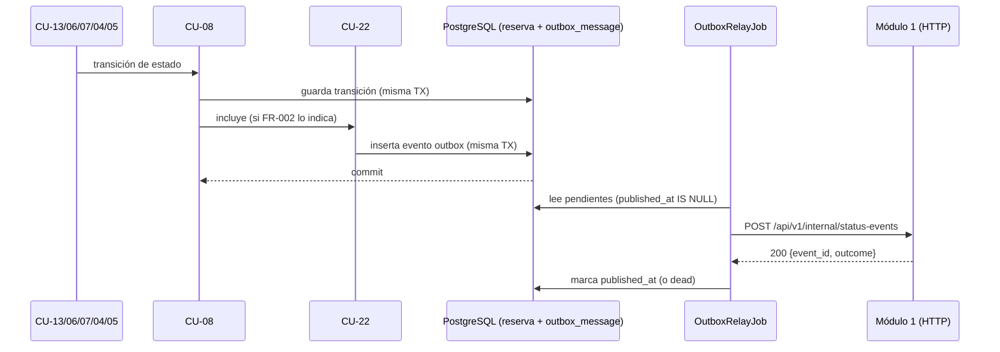
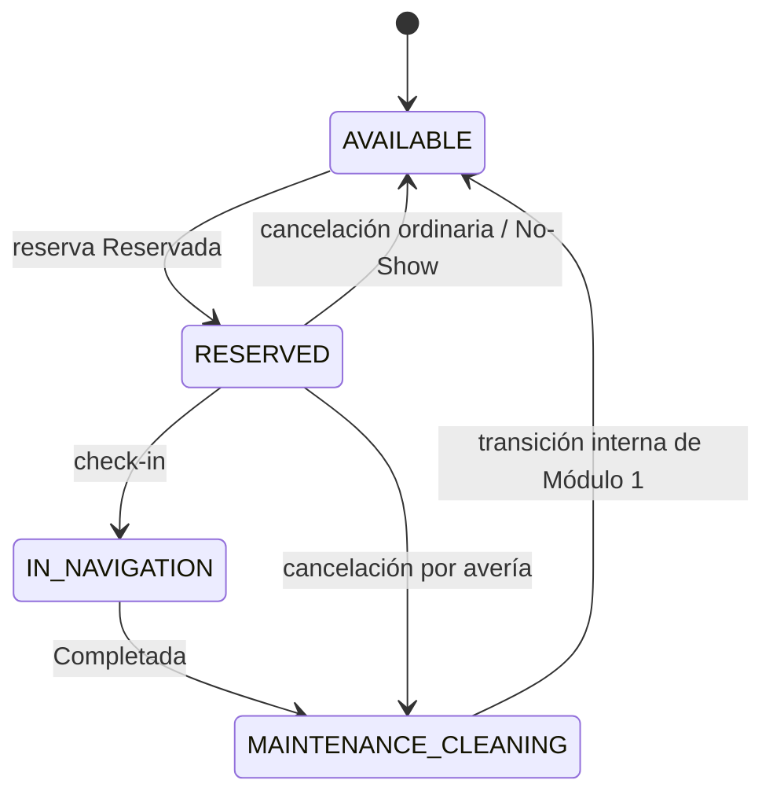

# Contrato de Interfaz Asíncrona: CU-22 Recibir Información de Estado Operativo

## 1. Identificación y Metadatos

- **Identificador del Contrato**: `ASYNC-M2-CU22-NOTIFICACION-ESTADO-OPERATIVO`
- **Módulo Responsable**: Módulo 2 – Operación de Reservas, Tiempos y Cancelaciones
- **Tipo de Interfaz**: Salida asíncrona por outbox (HTTP POST, destino M1_HTTP), saliente hacia Módulo 1, que responde de forma síncrona con `{event_id, outcome}`
- **Actor / Consumidor Autorizado**: 
  - `Módulo 1 – Gestión de Flota y Activos P2P` (consume la cola de Módulo 1 y materializa `Asignar estado operativo`)
- **Caso de Uso Base / Relaciones**: 
  - Incluido por: `Actualizar estado reserva` (`<<include>>` - CU-08), único disparador.
  - Relación hermana: `Recibir Estado de Reserva` (`CU-14` → Módulo 3), independiente; el fallo de una notificación no invalida la otra.
- **Contrato Técnico de Referencia**: `context/consistencia-m2-m1.md`
- **Versión del Contrato**: 1.0.0
- **Fecha de Creación**: 2026-10-22

---

## 2. Propósito y Alcance de la Interfaz

Esta interfaz asíncrona permite a Módulo 2 informar a Módulo 1 el **estado operativo de la embarcación ya mapeado** cada vez que una reserva consolida una transición notificable, para que el inventario náutico refleje los compromisos de navegación y los bloqueos de la plataforma.

### Responsabilidades de la Interfaz:

1. **Traducción de Estado (FR-002)**:
   - Módulo 2 envía el **estado operativo resultante**, nunca el estado crudo de la reserva.
   - La correspondencia vigente es la tabla de FR-002 de `features/CU-22-recibir-informacion-estado-operativo/spec.md`, que es su **única fuente de verdad**; su copia de referencia vive en `context/consistencia-m2-m1.md`.
2. **Encolado Transaccional (FR-005)**:
   - El evento se registra en el outbox **en la misma transacción local** que consolida la transición de estado de la reserva.
   - Un proceso aparte (`OutboxRelayJob`) publica el evento en RabbitMQ; la transición y su notificación se confirman juntas.
3. **Entrega Garantizada (FR-006)**:
   - No existe envío síncrono directo. La entrega se gobierna con reintentos, backoff exponencial con jitter y derivación a DLQ con alerta.
   - La entrega es *at-least-once*; Módulo 1 deduplica por identificador de evento.
4. **Idempotencia por Transición (FR-004)**:
   - Cada transición genera un `event_id` (UUID) único que se conserva en todos los reintentos y viaja en el cuerpo del POST.
5. **Regla de Negocio "Sin Dinero" (FR-007)**:
   - La notificación es puramente operativa: **jamás** incluye montos, tarifas, penalidades, valores de reembolso ni datos de liquidación o pago.
6. **Sin Respuesta Síncrona ni Reversión (FR-008)**:
   - Módulo 2 no espera una respuesta de negocio de Módulo 1 ni altera la transición local según el resultado de la entrega; la consistencia es eventual y se alcanza por reintento.
7. **Fuera de Alcance (FR-009)**:
   - No se valida ni resuelve doble reserva en el marco de esta notificación; esa prevención es responsabilidad interna de Módulo 2 y ocurre antes de confirmar la reserva.
   - No se notifican las transiciones a `Iniciada`, `Pendiente de pago`, `Expirada` ni `Pago Fallido`; `Cancelada` solo se notifica si la reserva ya había alcanzado `Reservada`.

---

## 3. Definición de la Interfaz

- **Protocolo**: HTTP POST a `/api/v1/internal/status-events` (`[CONFIRMAR CON M1]`), sin autenticación, enviado desde el outbox; Módulo 1 responde de forma síncrona con `{event_id, outcome}`
- **Operación**: una petición HTTP por evento del outbox con destino `M1_HTTP`
- **Formato de Mensaje**: `application/json`
- **Codificación**: `UTF-8`

### 3.1 Encabezados HTTP

| Header | Tipo | Obligatorio | Descripción |
| :--- | :--- | :--- | :--- |
| `Content-Type` | String | Sí | `application/json`. |
| `Accept` | String | No | `application/json`. |

> El identificador de deduplicación viaja en el cuerpo (`event_id`), no en un header `Message-Id`.

### 3.2 Destino y Enrutamiento

| Elemento | Valor | Descripción / Reglas |
| :--- | :--- | :--- |
| Método | `POST` | Confirmado para el despliegue del 2026-11-21 |
| Ruta | `/api/v1/internal/status-events` | Ruta del contrato de M1 (`[CONFIRMAR CON M1]`) |
| Autenticación | Ninguna | M1 no exige token en esta ruta (`[CONFIRMAR CON M1]`) |
| Exchange / routing key / cola | No aplica | No hay topología RabbitMQ para Módulo 1 |

> Las referencias anteriores a exchange, routing key y cola de Módulo 1 quedan sin efecto: el transporte es HTTP POST.

### 3.3 Flujo de Entrega

1. Un caso de uso de negocio (CU-13, CU-06, CU-07, CU-04 o CU-05) invoca a CU-08 para consolidar la transición de la reserva.
2. CU-08 aplica la tabla FR-002 y, si la transición es notificable, invoca a CU-22.
3. CU-22 genera el `event_id` y escribe el evento en `outbox_message` dentro de la misma transacción local.
4. Al confirmarse el commit, `OutboxRelayJob` reclama el pendiente y llama a `FleetStatusNotificationPort`.
5. En modo `http`, el adaptador envía `POST /api/v1/internal/status-events` con el payload del outbox.
6. Módulo 1 deduplica por `event_id`, aplica el estado y responde `{event_id, outcome}`.
7. El relay marca `published_at` si el `outcome` es `APPLIED`, `DUPLICATE`, `NO_CHANGE` o `STALE`; si es `UNKNOWN_VESSEL` o `INVALID_TRANSITION`, marca `dead`.



> Los pasos 3–5 son asíncronos respecto del flujo de negocio: el caso de uso no espera a Módulo 1.

---

## 4. Estructura de Datos (Schema JSON)

### 4.1 Cuerpo del Mensaje (Payload)

```json
{
  "vessel_id": "string (UUID)",
  "operational_status": "string (AVAILABLE | RESERVED | IN_NAVIGATION | MAINTENANCE_CLEANING)",
  "occurred_at": "string (ISO 8601 timestamp con zona horaria)",
  "event_id": "string (UUID)"
}
```

#### Descripción de Campos del Mensaje

| Campo | Tipo | Obligatoriedad | Descripción |
| :--- | :--- | :--- | :--- |
| `vessel_id` | String (UUID) | No nulo | Identificador de la embarcación en Módulo 1. |
| `operational_status` | String (Enum) | No nulo | Estado operativo resultante, ya mapeado (`AVAILABLE`, `RESERVED`, `IN_NAVIGATION`, `MAINTENANCE_CLEANING`). Nunca contiene el estado crudo de la reserva. |
| `occurred_at` | String (ISO 8601) | No nulo | Marca temporal exacta de la transición. Módulo 2 la emite en UTC (`Z`) porque serializa un `Instant` (`OutboxAdapter.java:124`); M1 acepta `Z` o un offset explícito (`[CONFIRMAR CON M1]`). |
| `event_id` | String (UUID) | No nulo | Identificador único por transición; se conserva en todos los reintentos. M1 lo documenta hasta 100 caracteres (`[CONFIRMAR CON M1]`); M2 envía un UUID de 36. |

Módulo 2 nunca añade campos extra: el payload tiene exactamente estos cuatro (`OutboxAdapter.java:120-141`).

### 4.2 Valores del Estado Operativo

| Valor | Significado |
| :--- | :--- |
| `AVAILABLE` | Disponible |
| `RESERVED` | Reservado |
| `IN_NAVIGATION` | En Navegación |
| `MAINTENANCE_CLEANING` | En Mantenimiento/Limpieza |

Módulo 1 acepta además los alias `NAVIGATION` y `MAINTENANCE` (`[CONFIRMAR CON M1]`). Módulo 2 sólo emite los cuatro valores canónicos; nunca publica nada fuera de la tabla de FR-002.

### 4.3 Respuesta de Módulo 1 (`[CONFIRMAR CON M1]`)

```json
{
  "event_id": "7f3c1a9e-2b64-4d0f-9c81-5a2d6e4b1101",
  "outcome": "APPLIED"
}
```

| `outcome` | Significado | Tratamiento en Módulo 2 (VERIFICADO) |
| :--- | :--- | :--- |
| `APPLIED` | El estado cambió | Entregado (`HttpFleetStatusNotificationAdapter.java:81`) |
| `DUPLICATE` | Ese `event_id` ya se procesó | Entregado (`:81`) |
| `NO_CHANGE` | La embarcación ya tenía ese estado | Entregado (`:81`) |
| `STALE` | El suceso es anterior al último cambio | Entregado (`:81`) |
| `UNKNOWN_VESSEL` | La embarcación no existe o es borrador | Permanente → `dead` (`:82`) |
| `INVALID_TRANSITION` | Transición fuera del contrato | Permanente → `dead` (`:82`) |

Un `outcome` ausente o desconocido se reintenta (`:76-79, :83-86`). El adaptador no compara el `event_id` de la respuesta con el enviado: es una mejora pendiente, no un requisito actual.

---

## 5. Ejemplos de Publicación

> Los ejemplos conservan el offset `-05:00` del contrato original; Módulo 2 emite `occurred_at` en UTC (`Z`) porque serializa un `Instant` (`OutboxAdapter.java:124`).

### Ejemplo 1: Reservada (bloqueo por pago confirmado)

```json
{
  "vessel_id": "d3b07384-d113-49cd-a5d6-812e9bcfc101",
  "operational_status": "RESERVED",
  "occurred_at": "2026-10-22T12:05:00-05:00",
  "event_id": "7f3c1a9e-2b64-4d0f-9c81-5a2d6e4b1101"
}
```

### Ejemplo 2: En navegación (check-in)

```json
{
  "vessel_id": "d3b07384-d113-49cd-a5d6-812e9bcfc101",
  "operational_status": "IN_NAVIGATION",
  "occurred_at": "2026-10-22T14:10:00-05:00",
  "event_id": "8a4d2b0f-3c75-4e1a-8d92-6b3e7f5c2202"
}
```

### Ejemplo 3: Completada (señal hacia Mantenimiento/Limpieza; el retorno a Disponible es interno de Módulo 1)

```json
{
  "vessel_id": "d3b07384-d113-49cd-a5d6-812e9bcfc101",
  "operational_status": "MAINTENANCE_CLEANING",
  "occurred_at": "2026-10-25T18:30:00-05:00",
  "event_id": "9b5e3c1a-4d86-4f2b-9e03-7c4f8a6d3303"
}
```

### Ejemplo 4: Cancelada ordinaria (liberación; sólo si ya había llegado a Reservada)

```json
{
  "vessel_id": "d3b07384-d113-49cd-a5d6-812e9bcfc101",
  "operational_status": "AVAILABLE",
  "occurred_at": "2026-10-24T10:00:00-05:00",
  "event_id": "0c6f4d2b-5e97-4a3c-8f14-8d5a9b7e4404"
}
```

### Ejemplo 5: Cancelada por avería mecánica (señal hacia Mantenimiento/Limpieza; sólo si ya había llegado a Reservada)

```json
{
  "vessel_id": "d3b07384-d113-49cd-a5d6-812e9bcfc101",
  "operational_status": "MAINTENANCE_CLEANING",
  "occurred_at": "2026-10-24T10:00:00-05:00",
  "event_id": "1d7a5e3c-6f08-4b4d-9a25-9e6b0c8f5505"
}
```

---

## 6. Respuestas de Error, Reintentos y Códigos

La interfaz es unidireccional en lo de negocio: Módulo 2 no recibe una respuesta de negocio, pero sí un `outcome` técnico. Los fallos se gestionan en el relay del outbox.

| Situación / Código | Causa | Reacción del Relay | Impacto en la Transición |
| :--- | :--- | :--- | :--- |
| `200` con `APPLIED`, `DUPLICATE`, `NO_CHANGE` o `STALE` | Aviso aceptado o ya conocido | Marca `published_at` | La transición local ya está confirmada |
| `200` con `UNKNOWN_VESSEL` o `INVALID_TRANSITION` | Rechazo definitivo de M1 | Marca `dead=true` y alerta; sin reintento | Sin reversión local |
| `200` sin `outcome` legible | Respuesta fuera de contrato | Reintento con backoff | Sin reversión local |
| **`4xx`** | Aviso inválido, ruta o método equivocados, token | `dead=true` sin reintento (`HttpFleetStatusNotificationAdapter.java:62-63`) | Sin reversión local |
| **`5xx` o Timeout** | Indisponibilidad transitoria de Módulo 1 | Reintento con backoff; máximo 5 intentos | Sin reversión local |
| Módulo 1 inalcanzable | Conexión rechazada o timeout | Reintento con backoff | Sin reversión local |
| Quinto fallo agotado | Se agotó la política de reintentos | `dead=true` + alerta crítica en el log; no hay DLQ | Sin reversión local |
| Outbox no se puede escribir | Fallo de la transacción local | Falla la transacción completa | La transición no se consolida |

Política: máximo 5 intentos por evento (el primero inmediato), backoff exponencial con jitter de 1 s, 5 s, 25 s y 125 s, sólo ante 5xx o timeout (FR-006).

> Deuda de código: `408` y `429` también caen hoy en "4xx permanente" y matan el evento; deberían reintentarse (`[CONFIRMAR CON M1]` sobre si M1 los emite).

---

## 7. Notas Transversales y Reglas de Negocio Arquitecturales

### 7.1 Regla de Oro "Sin Dinero" (Zero Financial Footprint)
En estricto apego a `FR-007` y `SC-003`, la notificación es puramente operativa.
- El payload sólo contiene `vessel_id`, `operational_status`, `occurred_at` y `event_id`.
- Módulo 2 no calcula, incluye ni transmite montos, tarifas, penalidades, valores de reembolso ni datos de liquidación o pago; Módulo 1 interpreta el estado operativo y nada más.

### 7.2 Sin Espera de Respuesta de Negocio (Consistencia Eventual)
Módulo 2 no espera un acuse de negocio de Módulo 1 ni revierte la transición local si la entrega falla.
- La entrega se considera consumada cuando M1 responde `200` con un `outcome` aceptado (`APPLIED`, `DUPLICATE`, `NO_CHANGE`, `STALE`) (`FR-008`).
- Un fallo de entrega no invalida el cambio de estado ya consolidado; la divergencia se corrige por reintento o, agotada la política, por `dead=true` con alerta.

### 7.3 Idempotencia y Entrega At-Least-Once
La entrega es *at-least-once*.
- El `event_id` se genera una vez por transición y se conserva en todos los reintentos; viaja en el cuerpo, no en un header.
- Un falso timeout puede reenviar el mismo evento: Módulo 1 responde `DUPLICATE` y no vuelve a aplicar el estado operativo (`[CONFIRMAR CON M1]`).

### 7.4 Outbox Transaccional y Ausencia de Garantía de Orden
- El evento se escribe en `outbox_message` dentro de la misma transacción que la transición de estado (`FR-005`).
- `OutboxRelayJob` reclama los pendientes (`published_at IS NULL`, `dead = false`) y los envía por HTTP; marca `published_at` sólo tras un `outcome` aceptado.
- Este contrato **no garantiza orden** entre eventos de la misma embarcación; Módulo 1 descarta como `STALE` los avisos anteriores al último cambio (`[CONFIRMAR CON M1]`).

### 7.5 Transición Final Interna de Módulo 1
Cuando Módulo 1 recibe `MAINTENANCE_CLEANING`, gestiona por su cuenta el paso posterior a `Disponible`. Módulo 2 no lo notifica ni espera esa confirmación.



---

## 8. Trazabilidad de Requisitos

| Requisito Funcional / Criterio | Descripción en Spec | Cobertura en este Contrato |
| :--- | :--- | :--- |
| **FR-001** | Encolar la notificación cuando CU-08 consolide una transición notificable. | Sección 2 (responsabilidad 2) y sección 3.3. |
| **FR-002** | Enviar el estado operativo ya mapeado, nunca el estado crudo. | Sección 2 (responsabilidad 1), sección 4.2 y contrato `context/consistencia-m2-m1.md`. |
| **FR-003** | Payload con embarcación, estado mapeado y marca temporal ISO 8601. | Campos `vessel_id`, `operational_status` y `occurred_at` (sección 4.1). |
| **FR-004** | Identificador único por transición (`event_id`) para deduplicación. | Campo `event_id` en el cuerpo (secciones 3.1, 4.1 y 7.3). |
| **FR-005** | Identificador generado en la misma transacción (outbox). | Sección 3.3 (pasos 3–5) y sección 7.4. |
| **FR-006** | Entrega garantizada: reintentos y backoff. | Sección 6 y sección 3.3. Sin DLQ: `dead=true` + alerta. |
| **FR-007** | Prohibición absoluta de información financiera. | Sección 2 (responsabilidad 5) y sección 7.1. |
| **FR-008** | Sin espera de respuesta ni reversión local. | Sección 2 (responsabilidad 6) y sección 7.2. |
| **FR-009** | No resolver doble reserva en esta notificación. | Sección 2 (responsabilidad 7). |
| **FR-007 de CU-08** | Notificar el estado operativo a Módulo 1. | Toda la interfaz. |
| **SC-001** | 0% de eventos perdidos. | Outbox + reintentos + `dead=true` (secciones 3.3 y 6). |
| **SC-002** | Primer intento en menos de 500 ms. | Relay optimizado (sección 3.3); el POST usa connect 100 ms y read 5000 ms (`HttpFleetStatusNotificationAdapter.java:35,41`). |
| **SC-003** | Cero valores financieros en el cuerpo del mensaje. | Sección 7.1. |
| **SC-004** | 100% de eventos con identificador único. | Sección 4.1 y sección 7.3. |
| **SC-005** | Cero transiciones notificadas con el estado crudo de la reserva. | Sección 4.2 y contrato `context/consistencia-m2-m1.md`. |

---

## 9. Puntos Abiertos y Aclaraciones Necesarias

- **Último salto a Módulo 1 (resuelto el 2026-11-18)**: HTTP `POST /api/v1/internal/status-events` (destino `M1_HTTP`), sin autenticación (`[CONFIRMAR CON M1]`). No hay cola, exchange ni routing key de Módulo 1.
- `[CONFIRMAR CON M1]` Catálogo completo de `outcome`, forma del `400` (`errors[{field,message}]`), límite de 100 caracteres de `event_id` y aceptación de offsets en `occurred_at`.
- `[CONFIRMAR CON M1]` Tratamiento de `408` y `429`: hoy todo 4xx se considera permanente y el evento queda `dead`.
- **Garantías de orden**: no las hay entre eventos de la misma embarcación; M1 descarta los anteriores como `STALE` (`[CONFIRMAR CON M1]`).

### 9.1 Envío de `RESERVED` y fechas de la reserva

**Comportamiento actual (VERIFICADO)**: al confirmarse el pago, `ModuleNotificationMatrix` devuelve `RESERVED` (`ModuleNotificationMatrix.java:48`) y `ChangeReservationStatusService` encola el evento en el outbox en la misma transición (`ChangeReservationStatusService.java:164-170`). El payload no lleva fechas (`OutboxAdapter.java:120-141`).

**`ReservationOperationalDispatchJob`: [DECISIÓN PENDIENTE]**. El plan técnico lo describe para enviar `RESERVED` sólo cuando `start_date <= CURRENT_DATE` (`technical-plan/plan.md:240`), pero no existe en el código. No se elige aquí entre las alternativas.

**Nota de riesgo (a verificar, no afirmada)**: con el comportamiento actual M1 recibe `RESERVED` sin la fecha de inicio, y CU-10 de M2 sólo considera disponible el estado `AVAILABLE` (`HttpFleetOperationalStatusAdapter.java:64`). Si M1 interpreta `RESERVED` como bloqueo de la embarcación completa, una reserva pagada para una fecha futura dejaría la embarcación no disponible para otras fechas. **Verificar con M1 si `RESERVED` bloquea la embarcación completa o sólo el rango reservado** (`[CONFIRMAR CON M1]`).
